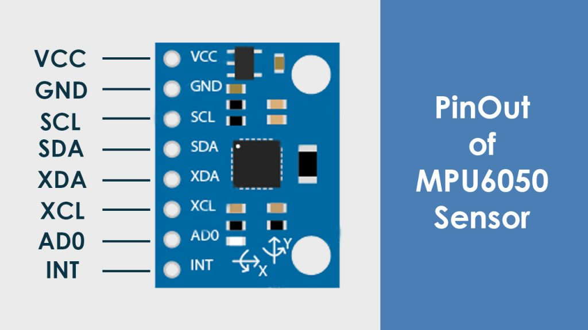
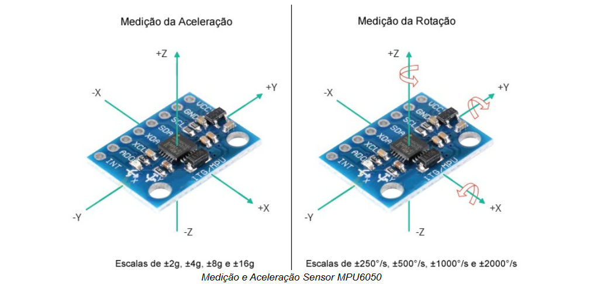

# MPU-6050

* **VCC** - 3V ou 5V
* **GND** - Terra

Comunicação (onde os dados passam) I2C:
* **SCL** - Digital
* **SDA** - Digital

Pinos auxiliares:
* **XDA e XCL** - I2C para conectar outro sensor. O acalerômetro consegue pegar informações de outro sensor e organizar a combinar as 2 informações (do próprio MPU e do outro sensor).

* **AD0** - Define o endereço do sensor. Se estiver em 0, o endereço é 0x68. Se estiver em 1, o endereço é 0x69. Permite uqe não tenha conflito de informações caso tenha 2 acelerômetros no mesmo projeto.

* **INT** - Pino que permite que o acelerômetro controle quando enviar os dados para a placa. O acelerômetro só envia os dados quando o microcontrolador pede. Isso é útil para economizar energia.

# Medição - Aceleração e Rotação

### 1. Medição da Aceleração Linear (Vibração e Impacto)
O acelerômetro atua como um sismógrafo de alta sensibilidade para a estrutura.
* **Vibração Dinâmica:** Detecta a oscilação causada pela passagem de veículos pesados. O movimento repetitivo de "vai e vem" da estrutura é captado como variações bruscas na aceleração (focadas principalmente no eixo Z, vertical).
* **Análise de Fadiga:** Analisando a frequência dessas oscilações, podemos descobrir a "assinatura vibratória" da ponte. Alterações na frequência natural ao longo do tempo podem indicar fadiga de material, enfraquecimento de vigas ou fissuras internas.
* **Impactos:** Picos extremos e repentinos de aceleração nos eixos X ou Y podem registrar colisões anômalas (ex: impacto de embarcações nos pilares ou acidentes severos).

### 2. Medição de Rotação Angular (Inclinação e Torção)
O giroscópio mede a taxa em que a estrutura gira em torno de seus próprios eixos.
* **Deflexão e Flexão:** Permite monitorar o quanto o tabuleiro da ponte "dobra" ou cede temporariamente durante um evento de carga máxima (como um engarrafamento de caminhões), medindo a alteração do ângulo.
* **Torção Estrutural:** Identifica se um lado da ponte está sofrendo mais estresse que o outro (movimento de rolagem no eixo longitudinal), um dado vital para pontes pênseis ou estaiadas submetidas a ventos laterais fortes.
* **Assentamento de Pilares:** Variações lentas, contínuas e permanentes na inclinação estática alertam para o recalque (afundamento) do solo na base das fundações.